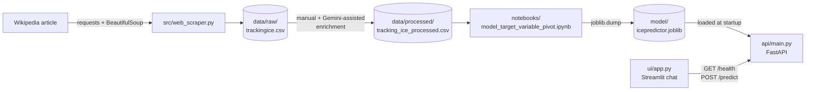

# P.R.E.D.I.C.T.I.C.E

An end-to-end machine learning project, built as the capstone for General Assembly's **Applied AI & Deep Learning** course (May 2026). It covers the whole workflow: web scraping, data enrichment, feature engineering, model training, a FastAPI inference service, and a Streamlit chat front end.

> [!IMPORTANT]
> **About the subject matter.** The dataset is public reporting of U.S. immigration enforcement actions (ICE and Border Patrol raids and arrests), taken from Wikipedia. I started this project to see whether the location of the next reported enforcement action could be predicted, so that people could stay informed and make safer decisions about where they go. Because the topic is politically sensitive and involves real people, the demo UI speaks through a fictional persona, the Iron Oracle. The model **does not perform better than simple baselines** and must not be used for real-world safety decisions. See [Limitations and responsible use](#limitations-and-responsible-use).

## Architecture



| Layer | Tools |
|---|---|
| Data collection | `requests`, BeautifulSoup + `lxml` |
| Data processing | pandas |
| Modelling | scikit-learn (`RandomForestClassifier`), joblib |
| Serving | FastAPI, Pydantic v2, Uvicorn |
| Front end | Streamlit |
| Experimentation | Jupyter |

## Technical implementation

### 1. Data collection: `src/web_scraper.py`

The scraper downloads [*List of immigration raids and arrests in the second Trump presidency*](https://en.wikipedia.org/wiki/List_of_immigration_raids_and_arrests_in_the_second_Trump_presidency) and collects every paragraph. The article isn't laid out as a clean DOM tree, so each paragraph gets a month label by keyword matching with a Python `match` statement and guard clauses. Paragraphs that match no month are printed for manual review. The output is a two-column CSV (`month`, `event`) in `data/raw/`.

### 2. Data enrichment: `data/processed/`

The processed dataset adds four columns to the raw scrape:

- `day_with_month` and `year`: added by hand, checked against the source article.
- `city` (`"City, State"`) and `zip_code`: extracted from the event text with Google Gemini. The prompts are documented in [`data/README.md`](data/README.md).

The final dataset has **169 events from 7 January 2025 to 2 May 2026**.

### 3. Feature engineering and modelling: `notebooks/`

**First attempt: predict the next zip code** ([`model_training.ipynb`](notebooks/model_training.ipynb)). Events are sorted by date, and each event's features come from the previous event's zip code (`shift(1)`). This reached about 5% accuracy. The dataset has 104 distinct zip codes across 169 events, and 75 of them appear only once, which is too many classes to learn from so few observations.

**Pivot: predict the next state** ([`model_target_variable_pivot.ipynb`](notebooks/model_target_variable_pivot.ipynb)). This version shrinks the target's cardinality:

- The state is parsed out of `city` with a regex, which leaves **29 target classes** (28 states plus Washington, D.C.).
- Features are a one-hot encoding of the **previous event's state** and the **month** (41 binary `is_*` columns, from `pd.get_dummies`).
- The train/test split is **chronological** (`shuffle=False`, 80/20 → 134 train / 34 test), so the model never trains on events that happen after its test events.
- The model is a `RandomForestClassifier` with default hyperparameters, serialized to `model/icepredictor.joblib`.

### 4. Inference API: `api/main.py`

- The model is loaded **once at startup** with FastAPI's `lifespan` context manager and stored on `app.state`. Its class labels are cached there too.
- Some one-hot feature names aren't valid Python identifiers (`is_New York`, `is_D.C.`). The Pydantic request model maps them with `Field(alias=...)` and `populate_by_name=True`.
- Incoming requests are dumped by alias and reordered to `model.feature_names_in_`, so column order always matches training.
- Each response contains the predicted label and the probability for every class.

| Method | Path | Description |
|---|---|---|
| `GET` | `/` | Welcome message |
| `GET` | `/health` | Liveness check, returns `{"status": "ok"}` |
| `POST` | `/predict` | Takes 41 binary features and returns the predicted state with class probabilities |

Interactive Swagger docs are served at `http://127.0.0.1:8000/docs`. A complete example payload is in [`ui/demo.py`](ui/demo.py). Request and response look like this (truncated):

```jsonc
// request: previous event in Idaho, current month December
{ "is_Alabama": 0, "is_Idaho": 1, "is_New York": 0, "is_D.C.": 0, "is_December": 1, "...": 0 }

// response
{ "prediction_label": "<state>", "probabilities": { "Alabama": 0.0, "California": 0.0, "...": 0.0 } }
```

### 5. Chat front end: `ui/app.py`

A Streamlit chat app that keeps conversation history in `st.session_state` and streams replies word by word with `st.write_stream` and Python generators. It has **no LLM behind it**. I left one out to keep the project free to run, since an LLM would add per-request API costs. Two commands call the API:

| Prompt | Behaviour |
|---|---|
| `healthcheck` | Calls `GET /health` and reports the backend status |
| `predict` | Sends the sample payload in `ui/demo.py` to `POST /predict`, then shows the predicted state and its probability |
| anything else | Returns a random pre-written in-character reply |

All replies are written in the voice of the Iron Oracle, a fictional, theatrical persona. Every prediction ends with a reminder that the app is a classroom demonstration.

## Results

All numbers are test accuracy on the same chronological hold-out (the 34 most recent events).

| Approach | Test accuracy |
|---|---|
| Uniform random guess (1 of 29) | 3.4% |
| **Random forest (shipped model)** | **8.8%** |
| Majority class (always predict "California") | 11.8% |
| Persistence (predict the previous event's state) | ~29–32%* |

\* I computed the baselines after the course ended, from the processed CSV. The persistence result moves within that range depending on how events that share a date are ordered.

**The shipped model does worse than both naive baselines.** Some likely reasons:

- About 170 observations spread across 29 classes, many of which appear only a few times.
- Very sparse one-hot features.
- Distribution shift: California is the most frequent state in the training period, but the test period is led by Minnesota (6 of 34 events) and New York (5).

The persistence baseline shows that consecutive events tend to cluster in the same state. A better model would need to exploit that signal explicitly.

## Limitations and responsible use

This section follows the structure of a [model card](https://arxiv.org/abs/1810.03993).

- **Intended use:** an educational demonstration of an end-to-end ML workflow, from scraping to serving.
- **Out-of-scope use:**
  - any real-world decision about personal safety, travel, or enforcement activity
  - any attempt to track or identify individuals

  Predictions are no better than naive guesses (see [Results](#results)).
- **Reporting bias:** the data covers only events that were reported in the media and added to Wikipedia. The model learns where enforcement actions get **reported**, not where they happen.
- **Labelling:** city and zip code were extracted with an LLM and may contain errors. Month labels come from keyword matching.
- **On the persona:** the Iron Oracle persona is a presentation layer only. I chose it to keep the demo focused on the engineering, and to make it obvious that the app is a classroom project and not an alert service. It isn't meant to make light of the events in the data, which affect real people and families.

## Running locally

Requires Python 3.13+ (some pinned dependencies require it).

```bash
python -m venv .venv && source .venv/bin/activate
pip install -r requirements.txt
```

Start the backend and the front end in two terminals. Each must be launched from its own directory, because they use relative paths:

```bash
cd api && uvicorn main:app --reload     # http://127.0.0.1:8000
cd ui  && streamlit run app.py          # http://localhost:8501
```

- **Notebooks:** run them from inside `notebooks/` (e.g. `cd notebooks && jupyter lab`). They read `../data/processed/` and write `../model/`.
- **Scraper:** `cd src && python web_scraper.py` overwrites `data/raw/trackingice.csv`. It does **not** regenerate the processed dataset, which was enriched by hand.

## Project structure

```text
api/          FastAPI inference service
data/         raw scrape and processed (enriched) datasets
docs/archive/ original course-submission README with instructor feedback
model/        serialized random forest (joblib)
notebooks/    feature engineering and training experiments
src/          Wikipedia scraper
ui/           Streamlit chat front end and demo payload
```

## Future work

Most of these come from instructor feedback, recorded in the [archived course README](docs/archive/README_course_submission.md):

- Add baselines to the notebook (scikit-learn's `DummyClassifier`) and report precision and recall per class, not just accuracy.
- Replace `pd.get_dummies` with a scikit-learn `Pipeline`, using a `ColumnTransformer` with `OneHotEncoder`, so the training and serving schemas can't drift apart.
- Try sequence and time-series approaches (e.g. Prophet, StatsForecast), or reframe the problem as binary classification.
- Explore resampling (e.g. SMOTE), keeping in mind that it adds synthetic observations.
- Automate the enrichment step, add a map visualization, and put a real LLM agent behind the chat UI.

## Use of generative AI

- Google Gemini helped with data enrichment (city and zip-code extraction), choosing an algorithm, and writing a regex. Prompts are in [`data/README.md`](data/README.md) and [`notebooks/README.md`](notebooks/README.md).
- An AI assistant helped with the Pydantic alias syntax ([`api/README.md`](api/README.md)).
- This README was drafted with help from Claude (Anthropic).

## Data source and attribution

The event data comes from the Wikipedia article [*List of immigration raids and arrests in the second Trump presidency*](https://en.wikipedia.org/wiki/List_of_immigration_raids_and_arrests_in_the_second_Trump_presidency). Wikipedia text is licensed under [CC BY-SA 4.0](https://creativecommons.org/licenses/by-sa/4.0/). The files in `data/` contain text adapted from the article, with columns added during enrichment, and are shared under the same license.

The chat avatar (`ui/avatar/iron_mask.png`) is original artwork, drawn programmatically for this project.

## License

- **Code and model:** MIT License. See [`LICENSE`](LICENSE).
- **Data:** the contents of `data/` are adapted from Wikipedia and licensed under [CC BY-SA 4.0](https://creativecommons.org/licenses/by-sa/4.0/), as described above.
